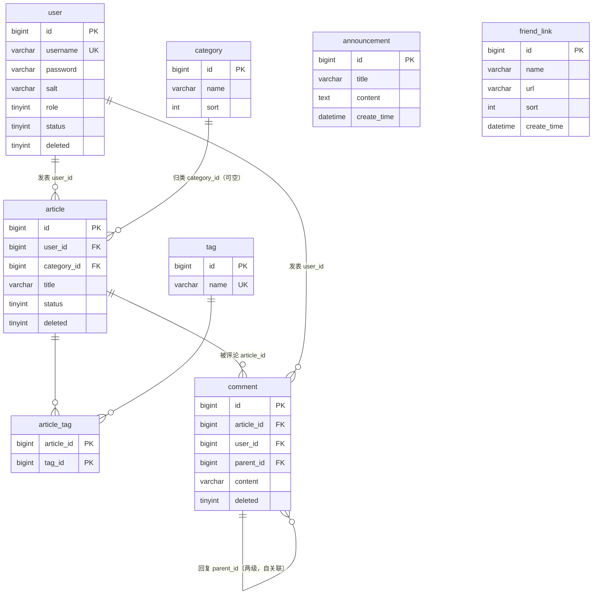

# 数据库设计说明书

**项目名称**：基于 Spring Boot 的博客系统
**数据库名**：`blog_db`
**文档版本**：V1.0
**编制日期**：2026-10-17
**权威来源**：`sql/init.sql`（建库建表 DDL + 初始数据）、`src/main/java/com/example/blog/entity` 实体类。本文档全部表结构、索引、约束均与 init.sql 逐一核对一致。

---

## 一、引言

### 1.1 编写目的

说明博客系统数据库的运行环境、总体结构、各表字段定义、索引、约束与表间关系，作为后端开发、联调、测试与部署的统一数据依据。

### 1.2 数据库环境

| 项目 | 配置 |
|------|------|
| 数据库管理系统 | MySQL 8.0（开发实测版本 8.0.44） |
| 数据库名 | `blog_db` |
| 字符集 | `utf8mb4`（支持 emoji 及全部中文字符） |
| 排序规则 | `utf8mb4_unicode_ci` |
| 存储引擎 | InnoDB（全部 8 张表） |
| JDBC 驱动 | `com.mysql.cj.jdbc.Driver`（MySQL Connector/J 8.x） |
| 时区 | Asia/Shanghai |
| ORM 框架 | MyBatis-Plus 3.5.x |

应用连接配置（`src/main/resources/application.yml`，账号密码走环境变量，不硬编码）：

```yaml
spring:
  datasource:
    driver-class-name: com.mysql.cj.jdbc.Driver
    url: jdbc:mysql://localhost:3306/blog_db?useUnicode=true&characterEncoding=utf-8
         &useSSL=false&serverTimezone=Asia/Shanghai&allowPublicKeyRetrieval=true
    username: ${DB_USERNAME:root}
    password: ${DB_PASSWORD:root}
```

建库语句：

```sql
CREATE DATABASE IF NOT EXISTS blog_db
  DEFAULT CHARACTER SET utf8mb4 COLLATE utf8mb4_unicode_ci;
```

### 1.3 命名与通用约定

| 约定 | 说明 |
|------|------|
| 表名 | 全小写、单数、下划线分词（如 `article_tag`、`friend_link`） |
| 主键 | 统一为 `id BIGINT NOT NULL AUTO_INCREMENT`（关联表 `article_tag` 除外，使用联合主键） |
| 时间字段 | `create_time`（创建时间，默认 `CURRENT_TIMESTAMP`）、`update_time`（更新时间，`ON UPDATE CURRENT_TIMESTAMP` 自动刷新） |
| 逻辑删除 | 需要软删除的表使用 `deleted TINYINT NOT NULL DEFAULT 0`：0=未删除，1=已删除；查询时由应用层过滤，不做物理删除 |
| 布尔/枚举 | 用 `TINYINT` 表示，含义在字段注释中明确（如 `role`、`status`） |
| 外键关系 | **数据库层不建立物理外键约束（FOREIGN KEY）**，表间关系由应用层（Service + MyBatis-Plus）保证，以获得更好的删除灵活性与批量导入性能 |
| 可重复性 | init.sql 使用 `DROP TABLE IF EXISTS` + 重建，可重复执行；建表后自动写入演示初始数据 |

---

## 二、数据库总体设计

### 2.1 表清单（共 8 张表）

| 序号 | 表名 | 中文名称 | 记录性质 | 初始数据量 |
|:----:|------|---------|---------|:----------:|
| 1 | `user` | 用户表 | 系统核心数据，逻辑删除 | 4 |
| 2 | `category` | 分类表 | 基础数据 | 5 |
| 3 | `tag` | 标签表 | 基础数据 | 8 |
| 4 | `article` | 文章表 | 核心业务数据，逻辑删除 | 6 |
| 5 | `article_tag` | 文章-标签关联表 | 多对多关联，联合主键 | 8 |
| 6 | `comment` | 评论表 | 业务数据，逻辑删除，自关联两级 | 6 |
| 7 | `announcement` | 公告表 | 站点运营数据 | 3 |
| 8 | `friend_link` | 友情链接表 | 站点运营数据 | 4 |

按功能域分组：用户域 1 张、内容域 4 张（category / tag / article / article_tag）、互动域 1 张（comment）、站点配置域 2 张（announcement / friend_link）。

### 2.2 实体关系（ER 图）



### 2.3 关系基数说明

| 关系 | 基数 | 维系字段 | 应用层约束 |
|------|------|---------|-----------|
| 用户 → 文章 | 1 : N | `article.user_id` | 文章必须有作者 |
| 分类 → 文章 | 1 : N | `article.category_id` | 可空（文章可不属于任何分类）；分类下有文章时禁止删除分类 |
| 文章 ↔ 标签 | M : N | `article_tag(article_id, tag_id)` | 发布/编辑文章时全量覆盖式更新关联；删标签时事务内解绑 |
| 文章 → 评论 | 1 : N | `comment.article_id` | 评论必须挂在存在的文章下 |
| 用户 → 评论 | 1 : N | `comment.user_id` | 评论人取当前登录用户 |
| 评论 → 评论 | 1 : N（自关联） | `comment.parent_id` | 两级结构；parent_id 为空=一级评论，非空=回复且只能指向一级评论 |
| 公告 / 友链 | 独立表 | — | 不与其他表发生关联 |

---

## 三、表结构详细设计

### 3.1 user 用户表

存储后台管理员与前台注册用户，通过 `role` 区分权限。

| 字段 | 类型 | 允许空 | 默认值 | 键 | 说明 |
|------|------|:------:|--------|:--:|------|
| id | BIGINT | 否 | AUTO_INCREMENT | PK | 用户ID |
| username | VARCHAR(50) | 否 | — | UK（uk_username） | 用户名，登录账号，唯一 |
| password | VARCHAR(100) | 否 | — | | 密码密文（MD5(盐+明文)，32 位） |
| salt | VARCHAR(32) | 否 | — | | 密码盐值（每用户随机） |
| nickname | VARCHAR(50) | 是 | NULL | | 昵称 |
| email | VARCHAR(100) | 是 | NULL | | 邮箱 |
| avatar | VARCHAR(255) | 是 | NULL | | 头像 URL（/upload/... 相对路径） |
| bio | VARCHAR(300) | 是 | NULL | | 个人简介 |
| role | TINYINT | 否 | 0 | | 角色：0-普通用户，1-管理员 |
| status | TINYINT | 否 | 1 | | 账号状态：0-禁用，1-启用 |
| deleted | TINYINT | 否 | 0 | | 逻辑删除：0-未删除，1-已删除 |
| create_time | DATETIME | 否 | CURRENT_TIMESTAMP | | 创建时间 |
| update_time | DATETIME | 否 | CURRENT_TIMESTAMP ON UPDATE CURRENT_TIMESTAMP | | 更新时间 |

索引：主键 `PRIMARY(id)`；唯一索引 `uk_username(username)`。

### 3.2 category 分类表

| 字段 | 类型 | 允许空 | 默认值 | 键 | 说明 |
|------|------|:------:|--------|:--:|------|
| id | BIGINT | 否 | AUTO_INCREMENT | PK | 分类ID |
| name | VARCHAR(50) | 否 | — | | 分类名称（应用层校验非空、≤50、不重名） |
| sort | INT | 否 | 0 | | 排序，值越小越靠前 |
| create_time | DATETIME | 否 | CURRENT_TIMESTAMP | | 创建时间 |

索引：主键 `PRIMARY(id)`（name 未建唯一索引，重名由业务层拦截）。

### 3.3 tag 标签表

| 字段 | 类型 | 允许空 | 默认值 | 键 | 说明 |
|------|------|:------:|--------|:--:|------|
| id | BIGINT | 否 | AUTO_INCREMENT | PK | 标签ID |
| name | VARCHAR(50) | 否 | — | UK（uk_tag_name） | 标签名称，唯一 |
| create_time | DATETIME | 否 | CURRENT_TIMESTAMP | | 创建时间 |

索引：主键 `PRIMARY(id)`；唯一索引 `uk_tag_name(name)`。

### 3.4 article 文章表

系统核心表，正文以 Markdown 存储。

| 字段 | 类型 | 允许空 | 默认值 | 键 | 说明 |
|------|------|:------:|--------|:--:|------|
| id | BIGINT | 否 | AUTO_INCREMENT | PK | 文章ID |
| user_id | BIGINT | 否 | — | MUL（idx_user_id） | 作者ID → user.id |
| category_id | BIGINT | 是 | NULL | MUL（idx_category_id） | 分类ID → category.id，可空 |
| title | VARCHAR(200) | 否 | — | | 标题 |
| cover | VARCHAR(255) | 是 | NULL | | 封面图 URL（/upload/...） |
| summary | VARCHAR(500) | 是 | NULL | | 文章摘要 |
| content | TEXT | 否 | — | | 正文（Markdown） |
| view_count | INT | 否 | 0 | | 浏览量 |
| status | TINYINT | 否 | 1 | MUL（idx_status） | 状态：0-草稿，1-已发布 |
| deleted | TINYINT | 否 | 0 | | 逻辑删除：0-未删除，1-已删除 |
| create_time | DATETIME | 否 | CURRENT_TIMESTAMP | | 创建时间（也作发布时间展示） |
| update_time | DATETIME | 否 | CURRENT_TIMESTAMP ON UPDATE CURRENT_TIMESTAMP | | 更新时间 |

索引：主键 `PRIMARY(id)`；普通索引 `idx_user_id(user_id)`、`idx_category_id(category_id)`、`idx_status(status)`。

### 3.5 article_tag 文章-标签关联表

文章与标签多对多关系的中间表，无独立主键列，使用联合主键。

| 字段 | 类型 | 允许空 | 默认值 | 键 | 说明 |
|------|------|:------:|--------|:--:|------|
| article_id | BIGINT | 否 | — | PK（联合） | 文章ID → article.id |
| tag_id | BIGINT | 否 | — | PK（联合）、MUL（idx_tag_id） | 标签ID → tag.id |

索引：主键 `PRIMARY(article_id, tag_id)`（同时充当按文章查标签的覆盖索引）；普通索引 `idx_tag_id(tag_id)`（支持按标签反查文章）。无时间字段、无逻辑删除（关联随文章标签编辑全量重建）。

### 3.6 comment 评论表

两级评论结构，通过 `parent_id` 自关联。

| 字段 | 类型 | 允许空 | 默认值 | 键 | 说明 |
|------|------|:------:|--------|:--:|------|
| id | BIGINT | 否 | AUTO_INCREMENT | PK | 评论ID |
| article_id | BIGINT | 否 | — | MUL（idx_article_id） | 文章ID → article.id |
| user_id | BIGINT | 否 | — | | 评论人ID → user.id |
| parent_id | BIGINT | 是 | NULL | MUL（idx_parent_id） | 父评论ID；NULL=一级评论，非空=回复（指向一级评论） |
| content | VARCHAR(500) | 否 | — | | 评论内容（≤500 字符） |
| deleted | TINYINT | 否 | 0 | | 逻辑删除：0-未删除，1-已删除 |
| create_time | DATETIME | 否 | CURRENT_TIMESTAMP | | 创建时间 |

索引：主键 `PRIMARY(id)`；普通索引 `idx_article_id(article_id)`、`idx_parent_id(parent_id)`。

业务规则：删除一级评论时，其下回复一并逻辑删除；展示时一次查询文章下全部评论后在内存中组装两级树（避免 N+1 查询）。

### 3.7 announcement 公告表

| 字段 | 类型 | 允许空 | 默认值 | 键 | 说明 |
|------|------|:------:|--------|:--:|------|
| id | BIGINT | 否 | AUTO_INCREMENT | PK | 公告ID |
| title | VARCHAR(200) | 否 | — | | 标题 |
| content | TEXT | 否 | — | | 公告内容 |
| create_time | DATETIME | 否 | CURRENT_TIMESTAMP | | 创建时间（列表按此倒序，首页取最新一条） |

索引：主键 `PRIMARY(id)`。无 update_time / deleted（公告只增删改，不做软删除）。

### 3.8 friend_link 友情链接表

| 字段 | 类型 | 允许空 | 默认值 | 键 | 说明 |
|------|------|:------:|--------|:--:|------|
| id | BIGINT | 否 | AUTO_INCREMENT | PK | 友链ID |
| name | VARCHAR(50) | 否 | — | | 网站名称 |
| url | VARCHAR(255) | 否 | — | | 网站地址（应用层校验 http:// 或 https:// 开头） |
| sort | INT | 否 | 0 | | 排序，值越小越靠前 |
| create_time | DATETIME | 否 | CURRENT_TIMESTAMP | | 创建时间 |

索引：主键 `PRIMARY(id)`。

---

## 四、索引设计汇总

| 表 | 索引名 | 索引列 | 类型 | 设计目的 |
|----|--------|--------|------|---------|
| user | PRIMARY | id | 主键 | 主键定位 |
| user | uk_username | username | 唯一 | 保证登录账号不重复，并加速登录查询 |
| category | PRIMARY | id | 主键 | 主键定位 |
| tag | PRIMARY | id | 主键 | 主键定位 |
| tag | uk_tag_name | name | 唯一 | 保证标签名不重复 |
| article | PRIMARY | id | 主键 | 主键定位 |
| article | idx_user_id | user_id | 普通 | 加速「我的文章」按作者查询 |
| article | idx_category_id | category_id | 普通 | 加速按分类浏览文章 |
| article | idx_status | status | 普通 | 加速按发布状态过滤（列表只查已发布） |
| article_tag | PRIMARY | (article_id, tag_id) | 联合主键 | 防重复关联 + 按文章查标签 |
| article_tag | idx_tag_id | tag_id | 普通 | 加速按标签反查文章 |
| comment | PRIMARY | id | 主键 | 主键定位 |
| comment | idx_article_id | article_id | 普通 | 加速按文章展示评论 |
| comment | idx_parent_id | parent_id | 普通 | 加速删除一级评论时定位其回复 |
| announcement | PRIMARY | id | 主键 | 主键定位 |
| friend_link | PRIMARY | id | 主键 | 主键定位 |

说明：当前数据量（课程项目 / 小型博客）下以上索引足以覆盖全部查询路径；未对低区分度列（如 `deleted`、`role`）单独建索引。

---

## 五、数据完整性与业务约束

1. **实体完整性**：所有表均有主键；除联合主键的关联表外，主键统一为自增 BIGINT。
2. **域完整性**：必填列均 `NOT NULL`；状态、角色等枚举值用 TINYINT + 注释约定，取值合法性由应用层（Service）校验。
3. **唯一完整性**：`user.username`、`tag.name` 在数据库层有唯一索引兜底；`category.name` 的唯一由业务层提前拦截（给出友好提示）。
4. **参照完整性（应用层保证，无物理外键）**：
   - 删除分类前检查其下文章数，有文章则拒绝（返回 400 与剩余文章数）；
   - 删除标签时在同一事务中删除 `article_tag` 关联行；
   - 删除文章标签关联前校验标签存在；
   - 发表评论校验文章存在、父评论存在且属于同一文章；
   - 文章的 `category_id` 允许为 NULL，分类删除后不会产生悬空外键问题。
5. **逻辑删除**：`user`、`article`、`comment` 三表含 `deleted` 字段，删除操作只置 1；评论为级联逻辑删除（父评论删除，回复同步置 1）。
6. **两级评论约束**：写入回复时若目标父评论本身是回复，自动归并到其所属一级评论，从数据源头杜绝三级嵌套。

---

## 六、安全设计

| 项 | 设计 |
|----|------|
| 密码存储 | 不存明文。注册时为每个用户生成随机 16 位盐值 `salt`，密码以 `MD5(salt + 明文密码)` 存入 `password`；登录用同样算法比对（见 `util/PasswordUtil`） |
| 数据库凭证 | `application.yml` 通过 `${DB_USERNAME}` / `${DB_PASSWORD}` 环境变量注入，默认值仅用于本地开发，生产部署必须用环境变量覆盖 |
| SQL 注入防护 | 全部数据访问使用 MyBatis-Plus / `#{}` 预编译参数，禁止用字符串拼接用户输入 |
| 文件上传 | 封面、头像落盘到配置目录 `file.upload-path`，按 `yyyy/MM/dd` 分目录、UUID 重命名，扩展名白名单（jpg/jpeg/png/gif/webp）+ 5MB 大小限制，防止路径穿越与文件覆盖 |
| 敏感信息 | 评论、文章等对外 VO 不返回用户邮箱、密码、盐值等字段 |

---

## 七、初始（演示）数据说明

init.sql 建表后写入一批可直接联调 / 演示的数据：

| 表 | 数据概要 |
|----|---------|
| user | 4 个账号：`admin/admin123`（管理员）、`zhangsan`、`lisi`（普通用户，密码均 abc123456）、`wangwu`（禁用账号，用于登录拦截联调）；密文均由 `MD5(CONCAT(salt, '明文'))` 在脚本内生成 |
| category | 后端开发、前端开发、数据库、运维部署、随笔杂谈（sort 1~5） |
| tag | Java、Spring Boot、MySQL、Vue、Redis、Docker、MyBatis、生活随笔 |
| article | 6 篇：5 篇已发布（含摘要、Markdown 正文、浏览量）+ 1 篇草稿 |
| article_tag | 8 条关联（如文章1关联 Java、Spring Boot；文章2关联 MySQL） |
| comment | 6 条评论，含 2 条回复（parent_id 非空），构成两级结构 |
| announcement | 欢迎使用博客系统、系统升级维护公告、社区评论规范 |
| friend_link | Spring 官方、MySQL 官网、Vue.js 官网、开源中国（sort 1~4） |

初始化命令（Windows PowerShell）：

```powershell
$env:MYSQL_PWD="你的root密码"
Get-Content sql/init.sql -Raw -Encoding UTF8 |
  & "C:\Program Files\MySQL\MySQL Server 8.0\bin\mysql.exe" -uroot --default-character-set=utf8mb4
```

---

## 八、附录：表与代码模块对照

| 表 | 实体类 | Mapper | 主要业务类 |
|----|--------|--------|-----------|
| user | entity/User | mapper/UserMapper | UserService、UserManageService |
| category | entity/Category | mapper/CategoryMapper | CategoryService |
| tag | entity/Tag | mapper/TagMapper | TagService |
| article | entity/Article | mapper/ArticleMapper | ArticleService |
| article_tag | entity/ArticleTag（复合主键，无自增 ID） | mapper/ArticleTagMapper | TagService（关联维护） |
| comment | entity/Comment | mapper/CommentMapper | CommentService |
| announcement | entity/Announcement | mapper/AnnouncementMapper | AnnouncementService |
| friend_link | entity/FriendLink | mapper/FriendLinkMapper | FriendLinkService |
